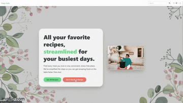

# Easy Eats
Making family recipes accessible to everyone, regardless of language.

**Link to project:** https://js-easy-eats.vercel.app/

    

**Tech used:** TailWind, DaisyUI, React

 

## How It's Made:

Easy Eats was built to make family recipes accessible regardless of the language someone speaks. The application supports English, Catalan, and Spanish, with the ability to change the language of the entire application instantly.

To accomplish this, I created a centralized translation object in translations.js, separating the content for each supported language. I then used React state to determine which language object should be rendered throughout the application. This allowed me to change the language of the entire experience without having to individually manage translations within each component.

 

<!-- ## Optimizations -->

## Lessons Learned:

*Centralizing Application Content*

I learned how to organize application content into JavaScript objects and use React state to dynamically determine which content should be displayed. This provided a more manageable approach to supporting multiple languages.

 

*Handling Client Side Routing*

I encountered an issue where refreshing a page on a nested route would result in a failed request on Vercel. I learned how to configure a vercel.json file to rewrite incoming requests to the application's entry point, allowing React Router to handle the routing.

 

*Customizing DaisyUI Themes*

I learned how to customize DaisyUI theme colors rather than relying on its default color palette, giving me more control over the application's appearance.

 

*Responsive Design with Tailwind CSS*

I learned how Tailwind's responsive prefixes work, particularly how unprefixed classes apply across screen sizes while prefixes such as sm: apply at specific breakpoints.

